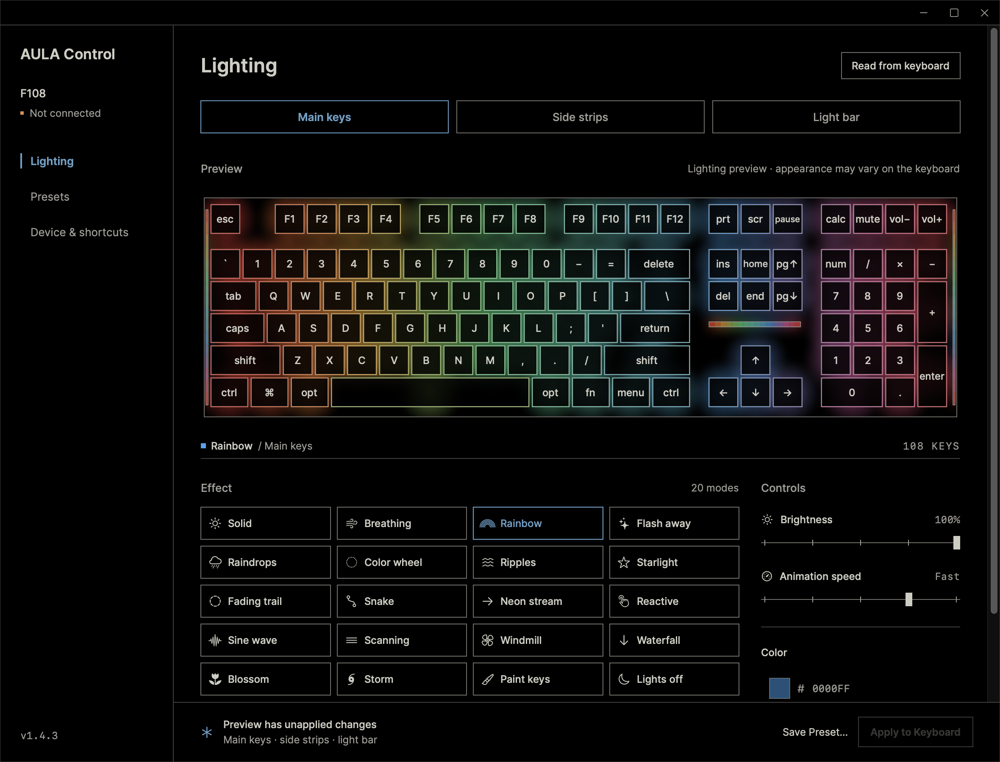

# AULA Control

A native macOS lighting controller for the **plain AULA F108**, connected through its 2.4 GHz USB receiver. Control the main keys, side strips, and light bar above the arrows without the Windows driver.



## Features

- Built-in lighting effects, brightness, animation speed, and main-key RGB colors.
- Independent side-strip and light-bar controls using their built-in colors.
- Per-key painting with LED positions read from the keyboard's own key map.
- Local presets with JSON import and export, plus menu-bar shortcuts.
- Animated previews, automatic configuration backups before writes, and receiver read-back checks.

The interface uses a black background, square controls, and a shared display palette for swatches and preview lights. Standard swatches send saturated device colors; the color picker and hex field send the exact RGB value selected. The preview illustrates lighting and does not predict the LEDs' color balance precisely.

## Compatibility

| Requirement | Support |
| --- | --- |
| Keyboard | Plain AULA F108, without the Pro display |
| Connection | 2.4 GHz USB receiver, keyboard switched to 2.4G |
| Receiver | Vendor `3554`, product `FA09`, vendor usage page `FF02` |
| Identity prefix | `03 00 00 00 01 BA` |
| macOS | 14 or later |
| Build tools | Swift 5.9 or later; Xcode or its command-line tools |
| Architecture | Apple silicon tested; Intel tests and builds pass in CI, with GUI rendering unverified |

The receiver IDs are shared by several models. The app checks identity and response formats before writing. **F108 Pro, wired USB configuration, and Bluetooth configuration are not supported.** Key remapping, macros, and firmware updates are outside this project's scope. See [validation coverage](docs/VALIDATION.md) for the difference between implemented effects and physically checked behavior.

## Build and install

```sh
swift test
./scripts/build.sh
open 'build/AULA Control.app'
```

There are no third-party Swift packages. Fonts and palette licenses are bundled locally. The build script creates and ad-hoc signs `build/AULA Control.app`; it does not install the app, access the keyboard, or change privacy permissions.

For regular use, quit the app and copy the complete bundle to `~/Applications` or `/Applications`, then open that installed copy. Build once and grant access to the final installed copy: rebuilding an ad-hoc signed app can invalidate an existing macOS permission.

In **System Settings → Privacy & Security → Input Monitoring**, enable AULA Control. If it is absent, click **+**, press **⌘⇧G**, enter the folder where you installed it, and choose `AULA Control.app`. `~/Applications` and `/Applications` are different folders. Reopen the app after granting access. See [connection and permission troubleshooting](docs/TROUBLESHOOTING.md) if access is still denied.

The source build is not Developer ID signed or notarized. Distribution and architecture-specific ZIP packaging are described in [the release guide](docs/RELEASING.md).

## Use

1. Select **Main keys**, **Side strips**, or **Light bar**.
2. Choose an effect and adjust its controls.
3. Select **Apply to Keyboard** or press **⌘ Return**.

Edits remain in the app until Apply. Apply sends changed zones; with Main keys selected, it also resends the main lighting even if the stored values already match. Effects run on the keyboard after the app closes.

In **Paint keys**, click a key to paint it. Shift-click to select more keys; changing color paints the selection. **Fill all** colors the complete LED map and **Clear** makes it black. Paint-mode intensity comes from each key's RGB channels rather than the main brightness slider.

Main keys support arbitrary RGB input. Side strips and the light bar expose seven built-in colors, with multicolor effects managed by the keyboard. A pale RGB mixture can appear close to white on the LEDs. Standard swatches therefore map to full-scale device colors, while their softer UI colors remain separate. This mapping applies to previews only when rendering; it never modifies saved RGB data or a custom hex value.

Use **Read from keyboard** to pick up physical Fn-key changes. The connection indicator reflects the last successful read, rather than a continuously monitored radio link. A message saying read-back matched confirms the returned data; it does not establish the visible appearance of the LEDs.

## Diagnostics and local data

```sh
'build/AULA Control.app/Contents/MacOS/AulaControl' --help
'build/AULA Control.app/Contents/MacOS/AulaControl' --diagnose
```

`--diagnose` reads device data and saves a local snapshot without writing keyboard settings. Commands that temporarily change the keyboard are explicitly identified in `--help` and the [development guide](docs/DEVELOPMENT.md).

Presets are stored in `~/Library/Application Support/AULA Control/presets.json`. Automatic snapshots are stored in the adjacent `Backups` directory. They remain on your Mac. The app has no network service or telemetry and discards ordinary keyboard input reports. See [privacy and security](SECURITY.md) before sharing diagnostic files.

## Documentation and contributions

- [Troubleshooting](docs/TROUBLESHOOTING.md): Input Monitoring, missing replies, and lighting mismatches.
- [Protocol reference](docs/PROTOCOL.md): report framing, field offsets, transfer order, and restoration.
- [Development guide](docs/DEVELOPMENT.md): source layout, diagnostic commands, and preset format.
- [Validation coverage](docs/VALIDATION.md): automated checks, physical observations, and limitations.
- [Design notes](docs/STYLE.md): display colors, animation, and neutral key borders.
- [Contributing](CONTRIBUTING.md): changes, hardware reports, and review expectations.
- [Release guide](docs/RELEASING.md): source and binary packaging.

## License and credits

Project code is available under the [MIT license](LICENSE). Required third-party notices remain in [Resources/ThirdPartyNotices.txt](Resources/ThirdPartyNotices.txt), including Aula-Manager's MIT attribution, Flexoki's MIT license, and Inter's SIL Open Font License. The [official F108 driver](https://aulagear.com/blogs/software/aula-f108-driver) and [manual](https://aulagear.com/blogs/manuals/aula-f108-manual) informed the device-specific implementation; their binaries are not distributed here.

This is an independent project, not affiliated with or endorsed by AULA. AULA's trademarks belong to their owners.
